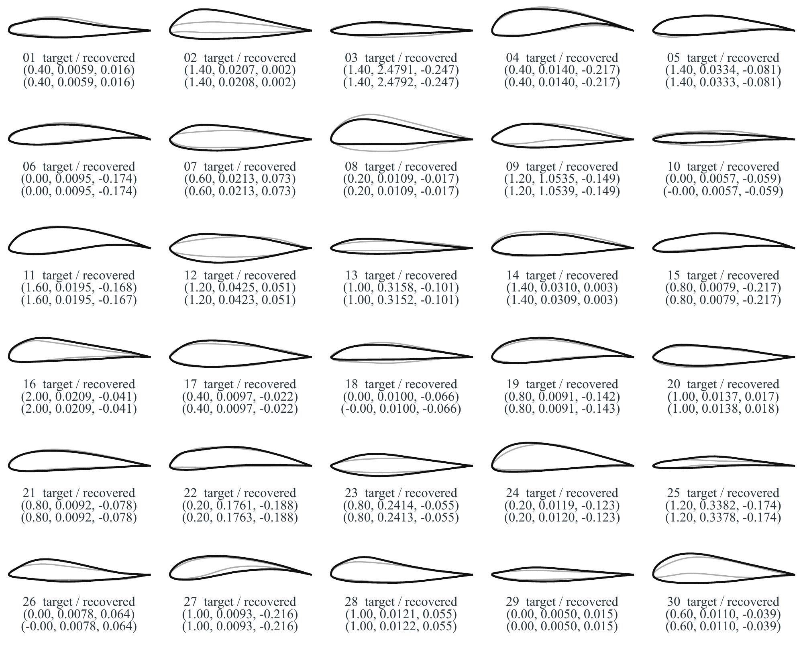

# Flow Airfoil

Reversible flow matching for bidirectional airfoil aerodynamic modeling.

A single conditional flow predicts lift, drag, and pitching moment from an observed 2D airfoil and generates airfoils for requested aerodynamic coefficients. The geometry uses class-shape transformation (CST) with ten Bernstein weights per surface.

W. Wei, Y. Zhang, P. Nian, Z. Han, and Y. Ma, “Reversible flow matching for bidirectional airfoil aerodynamic modeling,” manuscript under review at *Aerospace Science and Technology*.



The two rows beneath each profile show the target and reverse-recovered lift, drag, and pitching-moment coefficients, respectively.

## Installation

From the repository root, install the package from source with Python 3.10 or later. For GPU inference, select a [PyTorch build](https://pytorch.org/get-started/locally/) that matches your CUDA environment.

```sh
python -m pip install -e .
```

## Examples

### (1) Reconstruct an airfoil from CST coefficients

Pass the ten upper-surface coefficients followed by the ten lower-surface coefficients. The returned array contains normalized contour coordinates ordered from the upper trailing edge around the leading edge to the lower trailing edge.

```python
import numpy as np

from flow_airfoil.geometry import cst_shape_vector_to_coords

upper = np.array([0.16, 0.17, 0.18, 0.17, 0.16, 0.15, 0.15, 0.14, 0.13, 0.12])
lower = np.array([-0.14, -0.13, -0.12, -0.11, -0.10, -0.09, -0.09, -0.08, -0.08, -0.07])
coords = cst_shape_vector_to_coords(np.concatenate((upper, lower)), n_points=181)
```

### (2) Generate airfoils for an aerodynamic target

The example uses a main-model checkpoint supplied separately. For Mach 0.3 and an angle of attack of 2 degrees, request lift, drag, and pitching-moment coefficients of 0.6, 0.009, and -0.04.

```sh
flow-airfoil-generate --checkpoint checkpoints/best_run1.pt --device cpu --mach 0.3 --alpha 2.0 --cl 0.6 --cd 0.009 --cm -0.04 --out-dir out/generated
```

The command writes four DAT contours and a `candidates.json` file with their CST coefficients and geometry check results. Use a new output directory for each run.

### (3) Evaluate one airfoil with XFOIL

Install [XFOIL](https://web.mit.edu/drela/Public/web/xfoil/) separately and pass its executable path with `--xfoil`.

```sh
flow-airfoil-xfoil --xfoil /path/to/xfoil --dat out/generated/candidate_001.dat --mach 0.3 --alpha 2.0 --output out/xfoil_single
```

## Project layout

| Path | Contents |
| --- | --- |
| `src/` | CST geometry, model inference, data preparation, evaluation, and XFOIL interface |
| `examples/` | Generated airfoil results |
| `configs/` | Selected settings for the three main-model runs |

Additional main-model training code is planned for release after manuscript acceptance.

## References

- B. M. Kulfan, “Universal Parametric Geometry Representation Method,” *Journal of Aircraft*, 45(1), 142–158, 2008. [DOI](https://doi.org/10.2514/1.29958)
- J. Liu et al., “AFBench: A Large-scale Benchmark for Airfoil Design,” *NeurIPS*, 2024. [AFBench project](https://hitcslj.github.io/afbench/)

- M. Drela, "XFOIL: An Analysis and Design System for Low Reynolds Number Airfoils," in *Low Reynolds Number Aerodynamics*, Springer, pp. 1-12, 1989. [DOI](https://doi.org/10.1007/978-3-642-84010-4_1) · [XFOIL project](https://web.mit.edu/drela/Public/web/xfoil/)

## Citation

```bibtex
@misc{wei_reversible_airfoil_flow_matching,
  title  = {Reversible flow matching for bidirectional airfoil aerodynamic modeling},
  author = {Wei, Wenyu and Zhang, Yu and Nian, Peng and Han, Zhonghua and Ma, Yiyuan},
  note   = {Under review at Aerospace Science and Technology}
}
```
